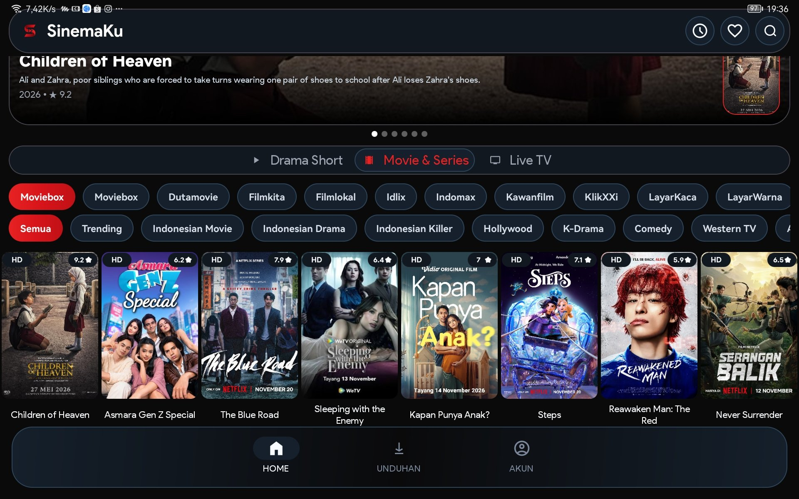
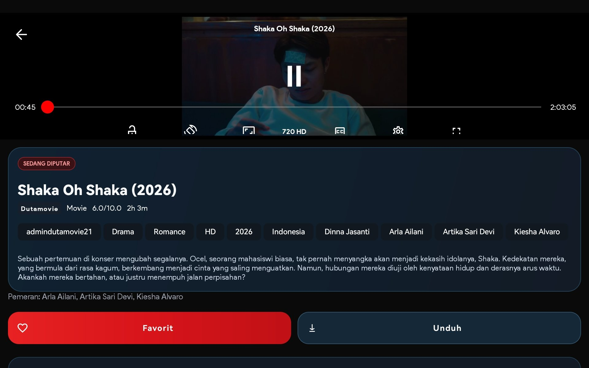
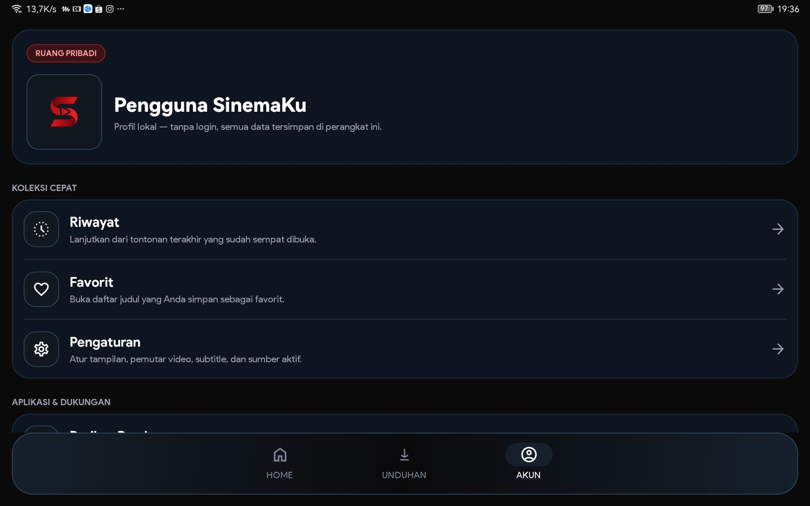
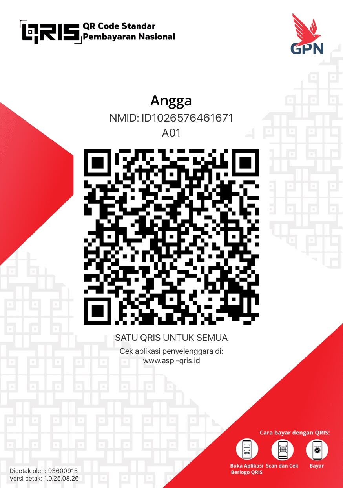

# SinemaKu

**Nonton film, serial, anime, drama pendek, dan Live TV Indonesia — gratis, tanpa iklan, tanpa login.**

[📥 Unduh APK Terbaru](https://github.com/Anqqasa/SinemaKu/releases)

<!-- Setelah rilis 1.0.0 terbit, ganti tautan di atas ke /releases/latest -->

---

## Tentang SinemaKu

SinemaKu adalah aplikasi streaming Android untuk menonton film, serial TV, anime, drama pendek, dan Live TV Indonesia dalam satu tempat. Dibangun dari basis open-source CloudStream, dengan tampilan dan fitur yang dirancang khusus untuk penonton Indonesia.

Semua konten berasal dari provider pihak ketiga. SinemaKu tidak menyimpan atau meng-host video apa pun.

## ✨ Fitur

- **Tanpa iklan, tanpa login** — buka aplikasi, langsung nonton
- **MovieBox sebagai provider utama**, didukung 18 provider Indonesia (Idlix, Dutamovie, LayarKaca, dan lainnya)
- **Pencarian toleran typo** — salah ketik sedikit tetap ketemu, lengkap dengan saran "Mungkin maksudmu…?"
- **Pre-check server** — server yang mati dicoret sebelum video diputar, jadi tidak buang waktu
- **Fallback pemutaran otomatis** — kalau satu server gagal, langsung pindah server lain, lalu provider lain, tanpa perlu mengetuk apa-apa
- **1080p diutamakan** — kualitas tertinggi selalu dicari duluan
- **Prefetch** — tautan video disiapkan selagi kamu menjelajah beranda, jadi film langsung main begitu diketuk
- **Trailer saat loading (opsional)** — sambil menunggu video utama, trailer diputar dulu; bisa dimatikan dari Pengaturan
- **Tekan-tahan 2x** — tahan sisi kanan pemutar untuk mempercepat 2x, lepas untuk kembali normal
- **Drama pendek** (OnShort) dan **Live TV Indonesia** (IndoTV)
- **Subtitle Indonesia otomatis** — selalu diutamakan bila tersedia
- **Lanjut nonton otomatis** — buka judul yang pernah ditonton, langsung lanjut dari posisi terakhir
- **Unduh offline** — simpan dan tonton tanpa internet
- **Backup & ekspor data** — riwayat, favorit, dan pengaturan bisa dipindahkan ke perangkat baru dalam satu file
- **Hero banner dari judul trending**, filter kategori (Film / Serial / Anime) dan filter provider yang bisa dikombinasikan
- **Pemutar inline** — video dan detail dalam satu layar, fullscreen hanya kalau kamu mau
- **Notifikasi error yang jelas** — lengkap dengan tombol Coba Lagi dan Coba Provider Lain
- **Chromecast** — putar ke TV
- **Bahasa Indonesia penuh** — mudah dipakai siapa saja

## 📸 Tampilan

  

<em>Beranda — hero banner, filter provider dan kategori, dan grid poster film dan serial.</em>

  

<em>Detail film dan pemutar — video, sinopsis, pemeran, dan tombol Favorit/Unduh dalam satu layar.</em>

  

<em>Tab Akun — profil lokal tanpa login, Riwayat, Favorit, dan Pengaturan.</em>

## 📥 Cara Install

1. Unduh file APK terbaru dari [halaman Releases](https://github.com/Anqqasa/SinemaKu/releases).
2. Buka file APK-nya di HP/tablet Android-mu (Android 6.0 ke atas).
3. Saat diminta, izinkan **"Install aplikasi tidak dikenal"** untuk browser/file manager-mu — cukup sekali saja.
4. Selesai. Tidak perlu daftar, tidak perlu login.

> **Pembaruan:** mulai versi 1.1.0, SinemaKu mengecek update sendiri dan mengunduh versi baru secara otomatis.

## 🗺️ Roadmap — versi 1.1.0

- Terjemahan subtitle otomatis ke Indonesia
- Notifikasi episode baru
- Pemilih tontonan berdasarkan mood dan waktu luang
- Widget "Lanjut Nonton" di home screen
- Profil keluarga tanpa login
- Dukungan Android TV (mode Leanback, navigasi remote)
- Cek update otomatis + unduh dan pasang APK baru
- Popup donasi QRIS ("Dukung SinemaKu")

## 👨‍💻 Pengembang

**Panji Angga Saputra** — Pengembang SinemaKu

- Instagram: [@Anqqasa](https://www.instagram.com/Anqqasa)
- GitHub: [Anqqasa](https://github.com/Anqqasa)

## ❤️ Dukung SinemaKu

  

SinemaKu dikembangkan secara sukarela dan gratis. Kalau aplikasi ini terasa membantu, kamu bisa ikut mendukung pengembangannya lewat donasi sukarela (QRIS). Tidak wajib — tapi sangat membantu untuk maintenance, update, dan eksperimen fitur baru.

## ⚠️ Disclaimer

SinemaKu adalah pemutar media open-source. Aplikasi ini tidak meng-host, mengunggah, atau menyimpan konten video apa pun — semua video dialirkan langsung dari server provider pihak ketiga. Gunakan dengan bijak dan patuhi hukum yang berlaku di wilayahmu.

## 🙏 Kredit

- Dibangun dari [CloudStream](https://github.com/recloudstream/cloudstream) (GPL-3.0)
- Provider Indonesia: repo [CloudX](https://github.com/Asm0d3usX/CloudX-V2), [IndoStream](https://github.com/TeKuma25/IndoStream), [cs-Karma](https://github.com/Kraptor123/cs-Karma)

## 📄 Lisensi

SinemaKu dilisensikan di bawah [GNU General Public License v3.0](LICENSE), mengikuti lisensi CloudStream.
